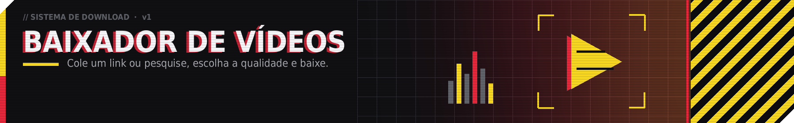
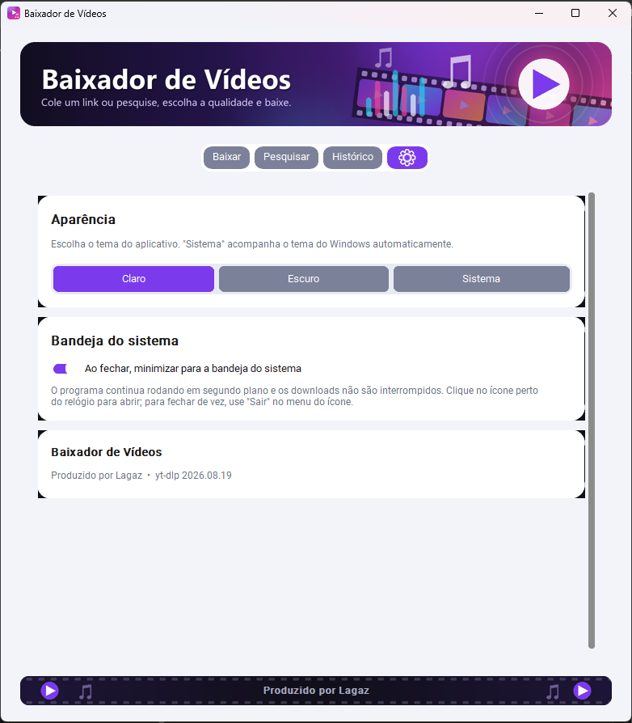

<p align="center">
  
</p>

<p align="center">
  Baixe vídeos do YouTube e de milhares de outros sites, escolhendo a qualidade.<br>
  <b>Produzido por Lagaz</b>
</p>

<p align="center">
  <a href="../../releases/latest"><b>⬇ Baixar o instalador para Windows</b></a>
</p>

<p align="center">
  <a href="../../releases/tag/android-v1.2.0"><b>📱 Baixar para Android (beta)</b></a>
</p>

---

## Como instalar

1. Abra a página **[Releases](../../releases/latest)** e baixe o arquivo **`BaixadorDeVideos_Setup.exe`**.
2. Dê dois cliques no arquivo e siga o assistente. Não precisa de Python nem de nenhum outro programa.
3. Pronto: o atalho fica no Menu Iniciar (e na Área de Trabalho, se você marcar a opção).

> **Aviso do Windows:** como o instalador não tem assinatura digital paga, o SmartScreen pode mostrar
> *"O Windows protegeu seu computador"*. Clique em **Mais informações** e depois em **Executar assim mesmo**.

Requisitos: Windows 10 ou 11 (64 bits).

## Recursos

- **Baixar por link:** cole o link, veja a miniatura e escolha a qualidade (até 4K) ou só o áudio em MP3.
- **Pesquisar:** busque vídeos no YouTube e no SoundCloud e baixe direto do programa.
- **Histórico:** todos os downloads ficam salvos, com botão para baixar de novo, abrir o arquivo ou a pasta.
- **Sugestão enquanto você assiste:** com a extensão do navegador, o programa avisa quando um vídeo está tocando e oferece o download.
- **Vídeos com restrição de idade:** usa o login do navegador ou um arquivo `cookies.txt`.
- **Tema claro, escuro ou do sistema**, e opção de minimizar para a bandeja do sistema.
- **Player embutido:** assista aos vídeos baixados na aba ▶ Player, com tela cheia, velocidade, repetir e próximo/anterior.
- **Três estilos visuais:** Clássico (padrão), Cyberpunk (amarelo, vermelho e cinza) e Retrô minimalista (creme, laranja e verde-petróleo). Troque na aba ⚙.
- **Tudo pronto:** FFmpeg e Deno já vêm no instalador.

<p align="center">
  
</p>

## Android (beta)

O app para celular tem os mesmos recursos: download por link com escolha de qualidade ou MP3, pesquisa,
histórico, player embutido, estilos Clássico, Cyberpunk e Retrô e tema claro, escuro ou do sistema.

- **Instalar:** baixe o APK **arm64** na [página da versão Android](../../releases/tag/android-v1.2.0),
  toque nele e permita instalar apps dessa fonte quando o Android pedir.
- **Baixar de qualquer app:** no YouTube, TikTok, Instagram ou no navegador, toque em **Compartilhar** e
  escolha **Baixador de Vídeos**.
- **Link copiado:** ao copiar o link de um vídeo e abrir o app, ele sugere o download.
- Os downloads continuam em segundo plano, com o progresso na barra de notificações.
- Os vídeos ficam em **Download/BaixadorDeVideos**.

## Extensão do navegador (opcional)

Ela faz o programa sugerir o download quando você está assistindo um vídeo no Edge, Chrome ou Brave.

1. No programa, abra a aba ⚙ e clique em **Instalar a extensão**.
2. No navegador, abra `edge://extensions` (ou `chrome://extensions`), ative o **Modo de desenvolvedor** e clique em **Carregar sem pacote**.
3. Escolha a pasta `extensao_navegador`, que fica na pasta onde o programa foi instalado.

A extensão só conversa com o programa no seu próprio computador. Nada é enviado para a internet.

## Perguntas comuns

**Um site parou de funcionar.** Os sites mudam com frequência. Baixe a versão mais nova na página de Releases.

**Vídeo com restrição de idade não baixa.** O YouTube exige login. Exporte um `cookies.txt` com a extensão *Get cookies.txt LOCALLY* e escolha **Arquivo cookies.txt...** no campo **Login do navegador**.

**Como desinstalar?** Configurações do Windows → Aplicativos → Baixador de Vídeos. Os vídeos baixados não são apagados.

## Para desenvolvedores

```bat
:: rodar pelo código-fonte (precisa do Python 3.10+)
executar.bat

:: gerar o instalador no próprio computador
gerar_instalador.bat
```

Para publicar uma versão nova, crie uma tag (por exemplo `v1.2.0`). O GitHub Actions gera o instalador
e coloca o arquivo na página de Releases sozinho.

## Uso responsável

Baixe apenas conteúdo que você tem direito de baixar e respeite os termos de uso de cada site.
Serviços com proteção anti-cópia (Netflix, Prime Video etc.) não são suportados.

## Licença

Código sob a [licença MIT](LICENSE). Componentes de terceiros em [THIRD_PARTY.md](THIRD_PARTY.md).
